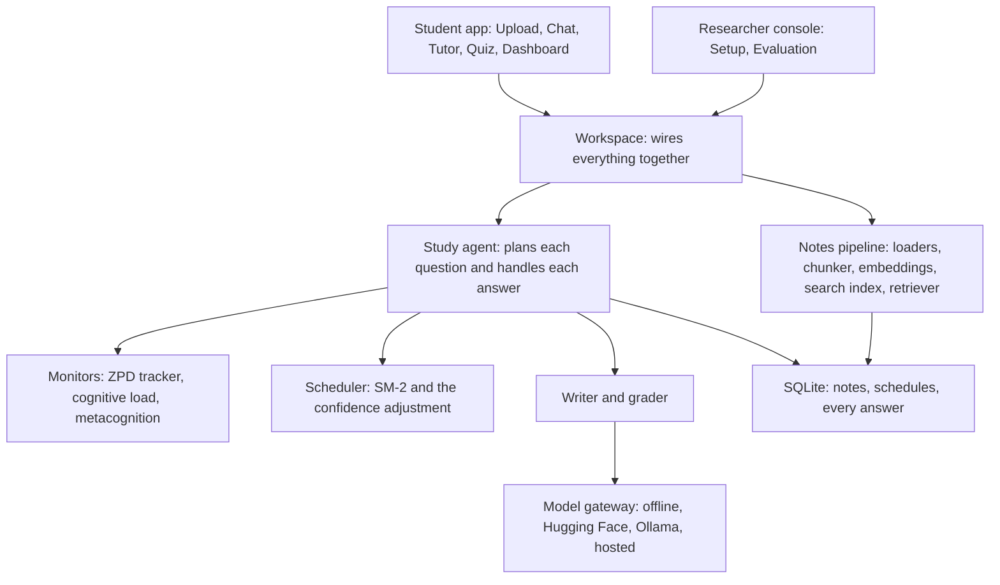
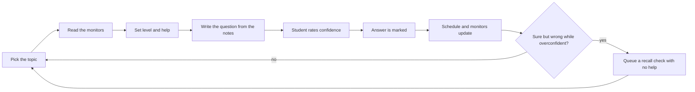

# Architecture

## Layers

## One question

## Where things live

| Folder | Purpose |
| --- | --- |
| `src/calibrayn/scheduler` | SM-2 and the confidence-based easiness adjustment |
| `src/calibrayn/orchestrator` | ZPD tracker, cognitive load, metacognition, policy, topic selector, study agent |
| `src/calibrayn/ingestion` | File loaders, chunker and the upload pipeline |
| `src/calibrayn/rag` | Embeddings, search index, retriever, prompts, writer, grounding check |
| `src/calibrayn/llm` | One interface to every model, plus detection of a local model |
| `src/calibrayn/storage` | SQLite database, library and progress |
| `src/calibrayn/services` | Grader, analytics and the workspace |
| `src/calibrayn/evaluation` | Question dataset, review and quality tools, search scores with baselines, grounding test, learner simulation, reports and command line |
| `src/calibrayn/hub` | Hugging Face: dataset reading, model download, dataset cards, publishing, Space deployment and command line |
| `deploy/huggingface` | The Dockerfile and card used for the Space |
| `src/calibrayn/ui` | The student app: Streamlit pages, palette, guidance and sample notes |
| `src/calibrayn/ui/console` | The researcher console: model setup and evaluation pages |
| `configs` | Every tunable number and the prompt files |
| `docs/decisions` | One short record per design decision |
